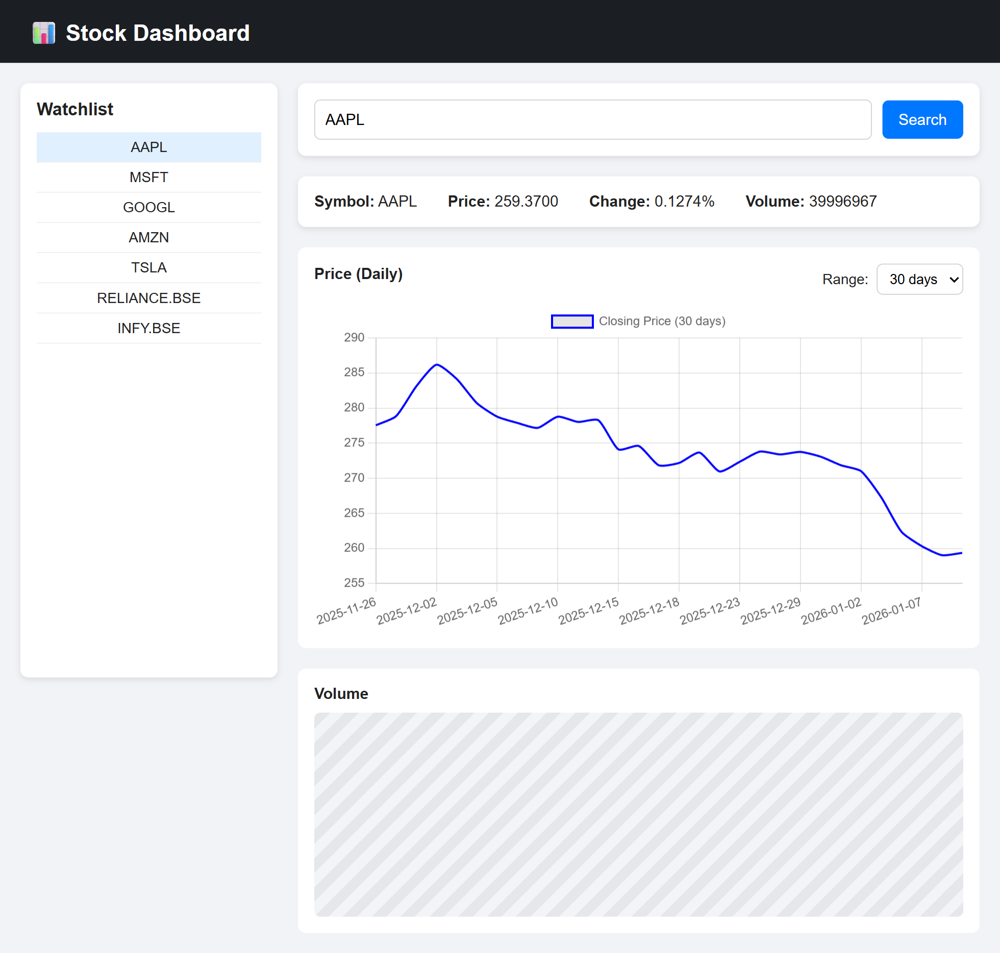
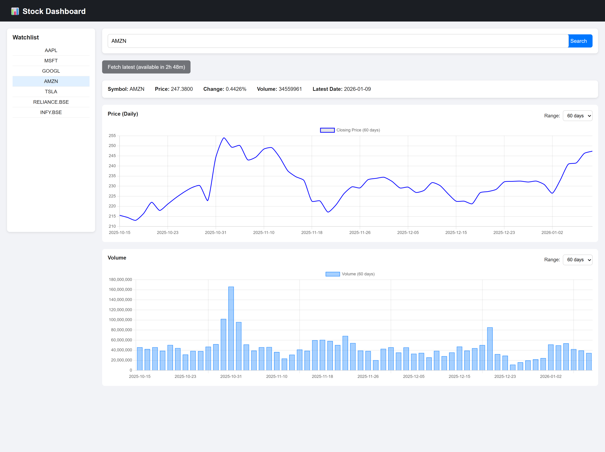
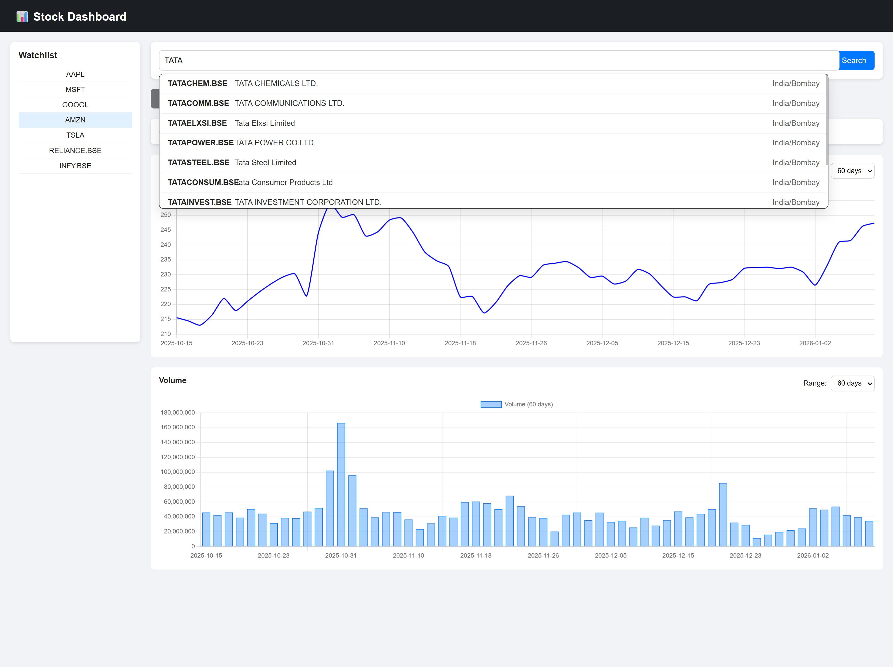

# Stock Dashboard (Flask + Alpha Vantage)

A small Flask web app that:
- shows a watchlist
- lets you search symbols (auto-complete via Alpha Vantage `SYMBOL_SEARCH`)
- renders Price + Volume charts using Chart.js
- shows quote info (price, change, volume, latest trading day)
- supports a “Fetch latest data” button with a 6-hour cooldown

## Screenshots

> Update the filenames below to match the screenshot image files you added in this project folder.

### Search + Auto-complete

### Dashboard (Charts + Watchlist)

### Another View

## Data sources

- Alpha Vantage `TIME_SERIES_DAILY` for chart data
- Alpha Vantage `GLOBAL_QUOTE` for the info box + `Global_Quotes.json`
- Alpha Vantage `SYMBOL_SEARCH` for auto-complete suggestions

## Caching behavior

### Watchlist symbols (`stocks_comp`)
- Chart data is cached on disk in `cache/<SYMBOL>.json`.
- `/stock/<symbol>` uses the cache when it is fresh; otherwise it fetches and updates the cache.
- `/refresh` updates the cached file (subject to cooldown).

### Non-watchlist (searched) symbols
- Chart data is fetched live and is **not written** into `cache/`.
- `/refresh` fetches live and updates `Global_Quotes.json`, but does not create a new cache file.

## Cooldown (6 hours)

- The “Fetch latest data” button is rate-limited.
- For watchlist symbols it is enforced using the cache file timestamp.
- For non-watchlist symbols it is enforced in-memory (resets when the server restarts).

## Run

1. Create a `.env` file with:
   - `API_KEY=<your_alpha_vantage_key>`
2. Install dependencies:
   - `pip install flask python-dotenv requests`
3. Start:
   - `python main.py`
4. Open:
   - `http://127.0.0.1:5000/`

## Endpoints

- `GET /` renders the dashboard (`?symbol=...`)
- `GET /stock/<symbol>?days=30|60|90` returns `{ dates, closes, volume }`
- `POST /refresh` body: `{ "symbol": "AAPL" }`
- `GET /search?keywords=tesla` returns auto-complete suggestions
